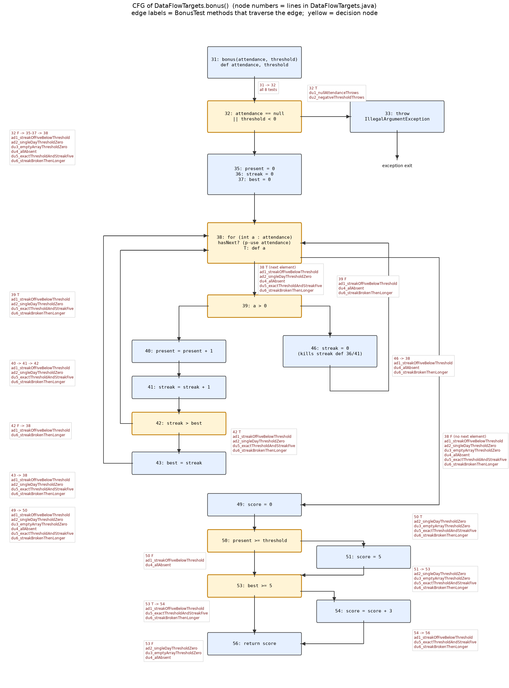

# Лаборатори №10: Өгөгдлийн урсгалын тест — Definition-Use хосууд

- **Нэр:** О.Оюунжаргал
- **Оюутны код:** B232270019
- **Хичээл:** F.CSA313 — Программ хангамжийн чанарын баталгаа ба тест (2026)

## Орчин

```
$ java -version
openjdk version "21.0.11" 2026-04-21
OpenJDK Runtime Environment Homebrew (build 21.0.11)
OpenJDK 64-Bit Server VM Homebrew (build 21.0.11, mixed mode, sharing)

$ mvn -version
Apache Maven 3.9.16 (2bdd9fddda4b155ebf8000e807eb73fd829a51d5)
Maven home: /opt/homebrew/Cellar/maven/3.9.16/libexec
Java version: 21.0.11, vendor: Homebrew, runtime: /usr/local/Cellar/openjdk@21/21.0.11/libexec/openjdk.jdk/Contents/Home
Default locale: en_MN, platform encoding: UTF-8
OS name: "mac os x", version: "26.6", arch: "x86_64", family: "mac"
```

## Хэсэг A — gcd(x, y)

Мөрийн дугаар нь `DataFlowTargets.java` файлын мөр (лекцийн 1, 3, 4, 5, 6, 8 нь 13, 15, 16, 17, 18, 20 болно).

### Def / use жагсаалт

| Мөр | Код | Def | Use |
|---|---|---|---|
| 13 | `gcd(int x, int y)` | x, y | |
| 14 | `int tmp;` | (зөвхөн зарлал, def биш) | |
| 15 | `while (y != 0)` | | y (p-use: T → 16, F → 20) |
| 16 | `tmp = x % y;` | tmp | x, y (c-use) |
| 17 | `x = y;` | x | y (c-use) |
| 18 | `y = tmp;` | y | tmp (c-use) |
| 20 | `return x;` | | x (c-use) |

### DU хосын хүснэгт

p-use хосыг T ба F салаагаар нь тусад нь тоолсон тул нийт 13 мөр.

| № | Хувьсагч | Def | Use | Төрөл | Def-clear зам | Тестийн ID | Хамрагдсан |
|---|---|---|---|---|---|---|---|
| 1 | x | 13 | 16 | c-use | 13 → 15 → 16 | G2, G3 | ✓ |
| 2 | x | 13 | 20 | c-use | 13 → 15 → 20 | G1 | ✓ |
| 3 | x | 17 | 16 | c-use | 17 → 18 → 15 → 16 | G3 | ✓ |
| 4 | x | 17 | 20 | c-use | 17 → 18 → 15 → 20 | G2, G3 | ✓ |
| 5 | y | 13 | 15 (T) | p-use | 13 → 15 → 16 | G2, G3 | ✓ |
| 6 | y | 13 | 15 (F) | p-use | 13 → 15 → 20 | G1 | ✓ |
| 7 | y | 13 | 16 | c-use | 13 → 15 → 16 | G2, G3 | ✓ |
| 8 | y | 13 | 17 | c-use | 13 → 15 → 16 → 17 | G2, G3 | ✓ |
| 9 | y | 18 | 15 (T) | p-use | 18 → 15 → 16 | G3 | ✓ |
| 10 | y | 18 | 15 (F) | p-use | 18 → 15 → 20 | G2, G3 | ✓ |
| 11 | y | 18 | 16 | c-use | 18 → 15 → 16 | G3 | ✓ |
| 12 | y | 18 | 17 | c-use | 18 → 15 → 16 → 17 | G3 | ✓ |
| 13 | tmp | 16 | 18 | c-use | 16 → 17 → 18 | G2, G3 | ✓ |

`tmp`-ийн ганц def нь 16 мөрөнд, ганц use нь 18 мөрөнд байна. Биелэшгүй хос алга: 13 мөр бүгд def-clear замтай бөгөөд тестээр хамрагдсан.

### Тестүүд (`GcdTest.java`)

| ID | Дуудлага | Давталт | Хамарсан хос (хүснэгтийн №) |
|---|---|---|---|
| G1 | `gcd(7, 0) = 7` | 0 | 2, 6 |
| G2 | `gcd(8, 4) = 4` | 1 | 1, 4, 5, 7, 8, 10, 13 |
| G3 | `gcd(12, 8) = 4` | 2 | 1, 3, 4, 5, 7, 8, 9, 10, 11, 12, 13 |

Хос № 2 ба 6-г зөвхөн G1, хос № 3, 9, 11, 12-г зөвхөн G3 хамарна.

- `gcd(7, 0)` нь `while`-д огт орохгүй тул 13 мөрийн def шууд 20 мөрөнд (x) ба 15 мөрийн F салаанд (y) хүрнэ. Эдгээр хоёр хосыг зөвхөн энэ тест хамарна.
- `gcd(12, 8)` нь яг 2 давталт хийнэ: 12 % 8 = 4 (x=8, y=4), дараа нь 8 % 4 = 0 (x=4, y=0).
- № 3, 9, 11, 12 хосын def нь 17 эсвэл 18 мөрөнд байх ба use-д нь дараагийн давталтад л хүрдэг тул эдгээр хос хамгийн багадаа 2 давталт шаардана. `gcd(8, 4)` нэг л давталт хийдэг тул тэдгээрийг хамарч чадахгүй.

## Хэсэг B — bonus(attendance, threshold)

### B1 — CFG



Зангилааны дугаар нь `DataFlowTargets.java`-гийн мөр. For-each давталт (38): нөхцөл нь attendance-д дараагийн элемент байгаа эсэх (attendance-ийн p-use), T салаа нь дараагийн элементийг `a`-д онооно (a-ийн def). 35–37 мөр салаагүй дараалал тул нэг зангилаанд нэгтгэсэн. Ирмэг бүрийн хажууд түүнийг дайрдаг `BonusTest`-ийн метод нэр бичигдсэн. Зургийг matplotlib-ээр зурсан.

### B2 — Def / use жагсаалт

Мөрийн дугаар нь `DataFlowTargets.java` файлын мөр.

| Мөр | Код | Def | Use |
|---|---|---|---|
| 31 | `bonus(int[] attendance, int threshold)` | attendance, threshold | |
| 32 | `if (attendance == null \|\| threshold < 0)` | | attendance (p-use), threshold (p-use, зөвхөн attendance != null үед) |
| 33 | `throw ...` | | |
| 35 | `int present = 0;` | present | |
| 36 | `int streak = 0;` | streak | |
| 37 | `int best = 0;` | best | |
| 38 | `for (int a : attendance)` | a (давталт бүрт) | attendance (p-use: дараагийн элемент байгаа эсэх) |
| 39 | `if (a > 0)` | | a (p-use) |
| 40 | `present = present + 1;` | present | present (c-use) |
| 41 | `streak = streak + 1;` | streak | streak (c-use) |
| 42 | `if (streak > best)` | | streak (p-use), best (p-use) |
| 43 | `best = streak;` | best | streak (c-use) |
| 46 | `streak = 0;` | streak | |
| 49 | `int score = 0;` | score | |
| 50 | `if (present >= threshold)` | | present (p-use), threshold (p-use) |
| 51 | `score = 5;` | score | |
| 53 | `if (best >= 5)` | | best (p-use) |
| 54 | `score = score + 3;` | score | score (c-use) |
| 56 | `return score;` | | score (c-use) |

Хувьсагч бүрийн def: attendance — 31; threshold — 31; present — 35, 40; streak — 36, 41, 46; best — 37, 43; score — 49, 51, 54; a — 38. Нийт 13 def.

### B3 — DU хүснэгт

p-use хосыг T/F салаагаар нь тусад нь тоолсон. Зам дахь `(43)` нь тухайн мөр заавал биш гэсэн үг.

| № | Хувьсагч | Def | Use | Төрөл | Def-clear зам | Тайлбар | Тестийн ID | Хамрагдсан |
|---|---|---|---|---|---|---|---|---|
| P1 | attendance | 31 | 32 (== null) T | p-use | 31 → 32 | null → throw | DU1 | ✓ |
| P2 | attendance | 31 | 32 (== null) F | p-use | 31 → 32 | | AD1, AD2, DU2–DU6 | ✓ |
| P3 | attendance | 31 | 38 (дараагийн элемент) T | p-use | 31 → 32 → 35 → 36 → 37 → 38 | | AD1, AD2, DU4, DU5, DU6 | ✓ |
| P4 | attendance | 31 | 38 (дараагийн элемент) F | p-use | 31 → 32 → 35 → 36 → 37 → 38 | давталт дуусна | AD1, AD2, DU3–DU6 | ✓ |
| P5 | threshold | 31 | 32 (< 0) T | p-use | 31 → 32 | attendance != null байх ёстой | DU2 | ✓ |
| P6 | threshold | 31 | 32 (< 0) F | p-use | 31 → 32 | | AD1, AD2, DU3–DU6 | ✓ |
| P7 | threshold | 31 | 50 T | p-use | 31 → 32 → 35 → 36 → 37 → 38 → 49 → 50 | threshold хаана ч дахин тодорхойлогдохгүй | AD2, DU3, DU5, DU6 | ✓ |
| P8 | threshold | 31 | 50 F | p-use | 31 → 32 → 35 → 36 → 37 → 38 → 49 → 50 | | AD1, DU4 | ✓ |
| P9 | present | 35 | 40 | c-use | 35 → 36 → 37 → 38 → 39 → 40 | зөвхөн эхний ирсэн өдөр (40 нь 35-г kill хийнэ) | AD1, AD2, DU5, DU6 | ✓ |
| P10 | present | 35 | 50 T | p-use | 35 → 36 → 37 → 38 → 49 → 50 | ирсэн өдөр 0 тул present = 0 >= threshold, threshold = 0 | DU3 | ✓ |
| P11 | present | 35 | 50 F | p-use | 35 → 36 → 37 → 38 → 49 → 50 | present = 0 < threshold | DU4 | ✓ |
| P12 | present | 40 | 40 | c-use | 40 → 41 → 42 → (43) → 38 → 39 → 40 | хоёр ба түүнээс олон ирсэн өдөр | AD1, DU5, DU6 | ✓ |
| P13 | present | 40 | 50 T | p-use | 40 → 41 → 42 → (43) → 38 → 49 → 50 | | AD2, DU5, DU6 | ✓ |
| P14 | present | 40 | 50 F | p-use | 40 → 41 → 42 → (43) → 38 → 49 → 50 | | AD1 | ✓ |
| P15 | streak | 36 | 41 | c-use | 36 → 37 → 38 → 39 → 40 → 41 | эхний элемент ирсэн өдөр байх ёстой | AD1, AD2, DU5, DU6 | ✓ |
| P16 | streak | 41 | 41 | c-use | 41 → 42 → (43) → 38 → 39 → 40 → 41 | дараалсан хоёр ирсэн өдөр | AD1, DU5, DU6 | ✓ |
| P17 | streak | 41 | 42 T | p-use | 41 → 42 | | AD1, AD2, DU5, DU6 | ✓ |
| P18 | streak | 41 | 42 F | p-use | 41 → 42 | streak <= best: өмнө нь урт цуваа байсан | AD1, DU6 | ✓ |
| P19 | streak | 41 | 43 | c-use | 41 → 42 → 43 | | AD1, AD2, DU5, DU6 | ✓ |
| P20 | streak | 46 | 41 | c-use | 46 → 38 → 39 → 40 → 41 | тасалсны дараа ирсэн өдөр | AD1, DU6 | ✓ |
| P21 | best | 37 | 42 T | p-use | 37 → 38 → 39 → 40 → 41 → 42 | эхний ирсэн өдөр | AD1, AD2, DU5, DU6 | ✓ |
| P22 | best | 37 | 42 F | p-use | 37 → 38 → 39 → 40 → 41 → 42 | **биелэшгүй** (доор) | — | ✗ (биелэшгүй) |
| P23 | best | 37 | 53 T | p-use | 37 → 38 → 49 → 50 → (51) → 53 | **биелэшгүй** (доор) | — | ✗ (биелэшгүй) |
| P24 | best | 37 | 53 F | p-use | 37 → 38 → 49 → 50 → (51) → 53 | ирсэн өдөр огт байхгүй | DU3, DU4 | ✓ |
| P25 | best | 43 | 42 T | p-use | 43 → 38 → 39 → 40 → 41 → 42 | цуваа үргэлжилнэ | AD1, DU5, DU6 | ✓ |
| P26 | best | 43 | 42 F | p-use | 43 → 38 → 39 → 46 → 38 → 39 → 40 → 41 → 42 | тасалсны дараа богино цуваа (46-г заавал дайрна: үгүй бол streak = best + 1 > best) | AD1, DU6 | ✓ |
| P27 | best | 43 | 53 T | p-use | 43 → 38 → 49 → 50 → (51) → 53 | best >= 5 | AD1, DU5, DU6 | ✓ |
| P28 | best | 43 | 53 F | p-use | 43 → 38 → 49 → 50 → (51) → 53 | 1 <= best <= 4 | AD2 | ✓ |
| P29 | score | 49 | 54 | c-use | 49 → 50 → 53 → 54 | 50 нь F байх ёстой (T бол 51 kill хийнэ) | AD1 | ✓ |
| P30 | score | 49 | 56 | c-use | 49 → 50 → 53 → 56 | 50 F, 53 F | DU4 | ✓ |
| P31 | score | 51 | 54 | c-use | 51 → 53 → 54 | 50 T, 53 T | DU5, DU6 | ✓ |
| P32 | score | 51 | 56 | c-use | 51 → 53 → 56 | 50 T, 53 F | AD2, DU3 | ✓ |
| P33 | score | 54 | 56 | c-use | 54 → 56 | | AD1, DU5, DU6 | ✓ |
| P34 | a | 38 | 39 T | p-use | 38 → 39 | | AD1, AD2, DU5, DU6 | ✓ |
| P35 | a | 38 | 39 F | p-use | 38 → 39 | | AD1, DU4, DU6 | ✓ |

Нийт 35 мөр, 2 нь биелэшгүй, 33 нь биелэх боломжтой бөгөөд 33-уулаа хамрагдсан (all-DU-pairs).

### Kill (дахин тодорхойлолтоор тасрах) тэмдэглэгээ

**Мөр 46 (`streak = 0`) нь streak-ийн 36 ба 41 дэх def-ийг алдгийг (kill) хийнэ.** Иймд эдгээр def-ээс 46-г дайрсан зам def-clear биш болно:

- 36 → 42, 36 → 43, 46 → 42, 46 → 43 хосууд def-clear замгүй тул DU хос биш. 42 ба 43 мөрд хүрэхийн өмнө үргэлж 41 (streak-ийн шинэ def) дайрдаг.
- 36 → 41 ба 41 → 41 хосууд 46-г дайрсан замаар kill болдог ч 46-г тойрсон def-clear зам байгаа тул DU хос хэвээр (P15, P16).

Бусад kill:
- 40 нь present-ийн 35 дахь def-ийг, 43 нь best-ийн 37 дахь def-ийг, 41 нь streak-ийн 36 дахь def-ийг алддаг.
- 51 нь score-ийн 49 дэх def-ийг алддаг тул 49 → 54 ба 49 → 56 нь зөвхөн 50 нь F (51-г алгасах) үед def-clear (P29, P30).

### Биелэшгүй хос

- **P22 (best 37 → 42 F):** 37-ийн def best-ийг 0 болгоно. 42-д хүрэхэд streak нь 41-д дөнгөж нэмэгдсэн тул streak >= 1, иймд `streak > best` үргэлж T. F салаа биелэхгүй.
- **P23 (best 37 → 53 T):** 37-ийн def 43-аар дарагдаагүй гэдэг нь ирсэн өдөр огт байхгүй гэсэн үг, тэгэхээр best = 0. `best >= 5` T болохгүй.

### B4 — 1-р шат: ALL-DEFS

bonus()-д 13 def байна. All-defs нь def бүрээс дор хаяж нэг use-д def-clear замаар хүрэхийг шаарддаг.

| ID | Дуудлага | Үр дүн | Хамарсан def (→ use) |
|---|---|---|---|
| AD1 | `bonus([1,1,1,1,1,0,1], 10)` | 3 | attendance31 → 32, threshold31 → 50, present35 → 40, present40 → 50, streak36 → 41, streak41 → 42, streak46 → 41, best37 → 42, best43 → 53, a38 → 39, score49 → 54, score54 → 56 |
| AD2 | `bonus([1], 0)` | 5 | score51 → 56 |

**Яагаад 2 тест, түүнээс цөөн болохгүй вэ.** score-ийн 49 дэх def use-д (54 эсвэл 56) хүрэхийн тулд 50 мөрийн нөхцөл F байх ёстой, учир нь 50 T бол 51 мөр түүнийг kill хийнэ. Харин 51 дэх def үүсэхийн тулд 50 T байх ёстой. Нэг гүйцэтгэлд 50 мөр нэг л удаа ажилладаг тул score49 ба score51 хоёрыг нэг тестээр хамрах боломжгүй. Үлдсэн 11 def-ийг AD1 нэг дор хамардаг тул 2 тест хангалттай.

`mvn verify` (results/mvn-verify-alldefs.txt): `Tests run: 5` (GcdTest 3 + BonusTest 2), BUILD SUCCESS.

`results/jacoco-alldefs.csv`: BRANCH_MISSED = 2, BRANCH_COVERED = 14 (14/16); LINE_MISSED = 2, LINE_COVERED = 22. Хамрагдаагүй 2 салаа нь 32 мөрийн `attendance == null` T ба `threshold < 0` T, хамрагдаагүй мөр нь 7 (далд constructor) ба 33 (throw). Exception-ийн салаанд ямар ч def байхгүй тул all-defs хангагдсан ч branch 100% биш байна.

### B4 — 2-р шат: ALL-DU-PAIRS

AD1, AD2 нь 33 биелэх хосоос 26-г хамарсан. Үлдсэн P1, P5, P10, P11, P24, P30, P31 хосуудад зориулж тест нэмсэн. DU6 нь "урт цуваа дунд нь тасрах; 5-аас урт цуваа" санааг шалгах нэмэлт тест (P18, P20, P25, P26-г давхар хамарна).

| ID | Дуудлага | Үр дүн | Шинээр хамарсан хос |
|---|---|---|---|
| DU1 | `bonus(null, 0)` | IllegalArgumentException | P1 |
| DU2 | `bonus([1], -1)` | IllegalArgumentException | P5 |
| DU3 | `bonus([], 0)` | 5 | P10, P24 |
| DU4 | `bonus([0,0], 1)` | 0 | P11, P30 |
| DU5 | `bonus([1,1,1,1,1], 5)` | 8 | P31 |
| DU6 | `bonus([1,1,0,1,1,1,1,1,1], 3)` | 8 | (давхар хамралт) |
